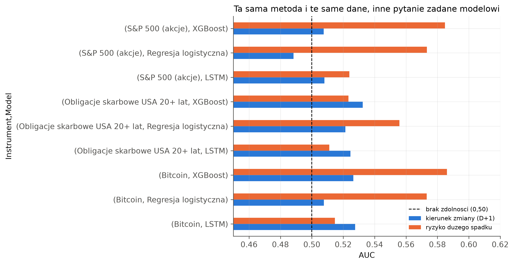
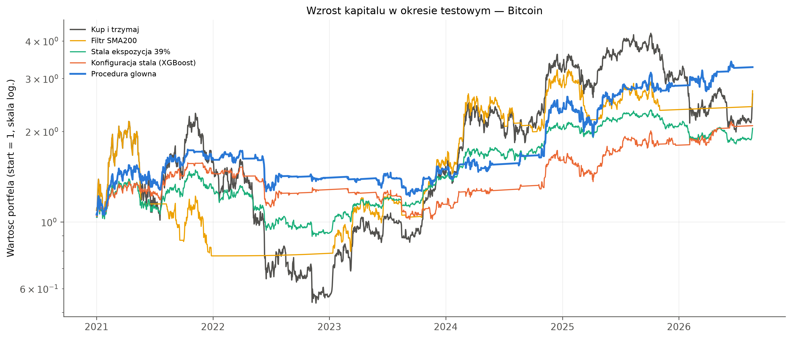
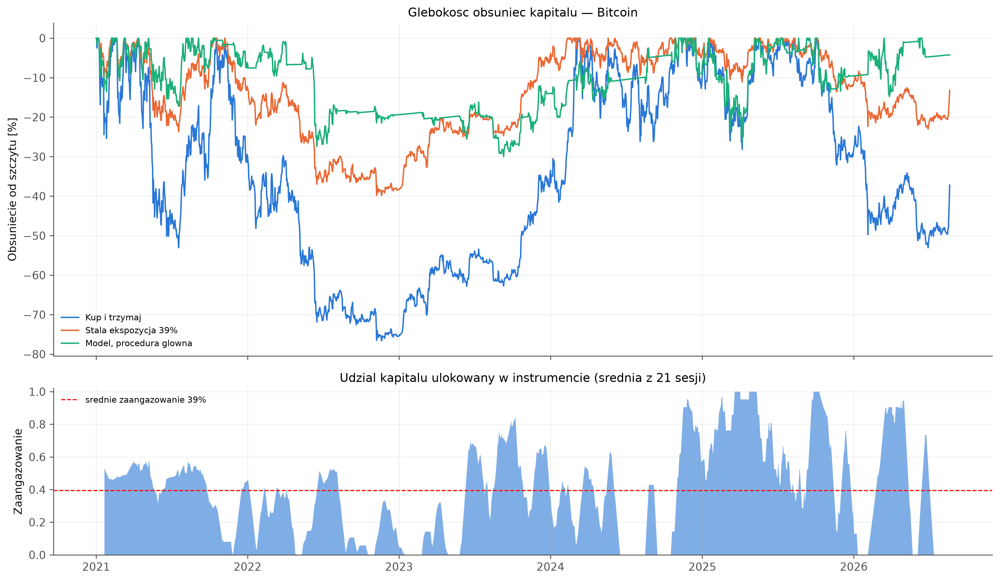
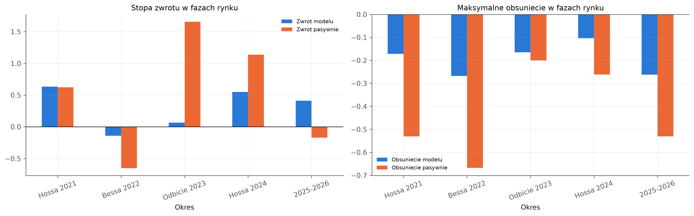
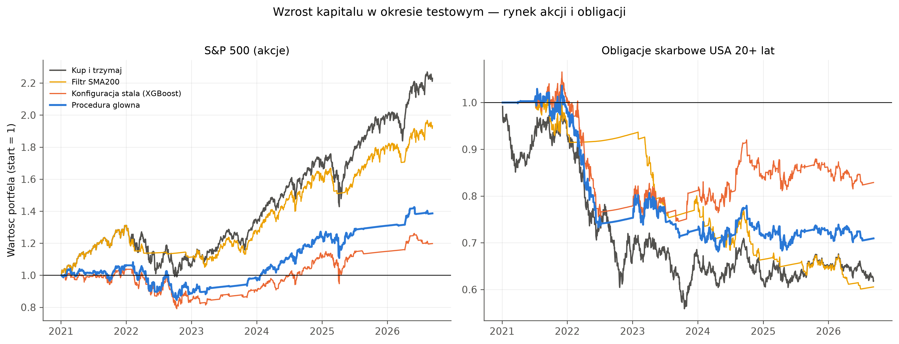
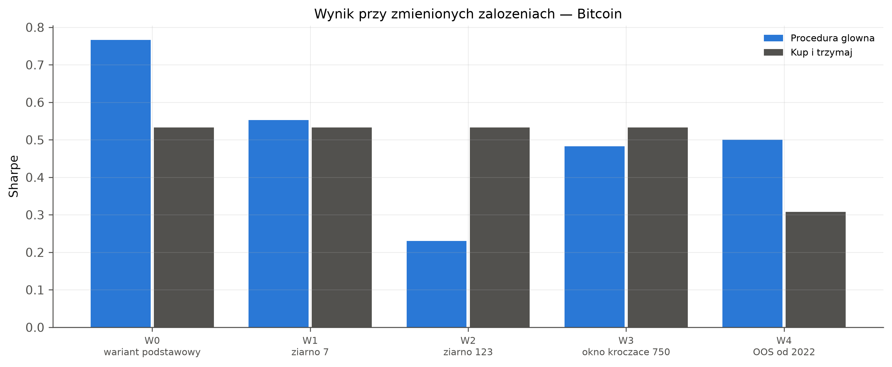

**English** · [Polski](README_PL.md)

# Buy & Hold vs machine learning strategies: BTC, SPY, TLT

A shortened version of my master's thesis (AGH University of Krakow, Computer Science and Econometrics). I checked whether trading rules based on logistic regression and XGBoost beat simply buying and holding bitcoin, an S&P 500 ETF (SPY) and a long-term US Treasury ETF (TLT). The test period runs from January 2021 to August/September 2026, and all results are after transaction costs.

**Main result:** on BTC the adaptive XGBoost strategy cut the maximum drawdown from −77% to −30% and raised the Sharpe ratio from 0.53 to 0.77. The Sharpe gain is not statistically significant (p = 0.43), and the result does not carry over to SPY, TLT or ETH.

**Tools and methods:** Python (pandas, NumPy, scikit-learn, XGBoost, TensorFlow/Keras) · machine learning classification (logistic regression, gradient boosting, LSTM) · feature engineering · hyperparameter tuning · class imbalance handling · walk-forward validation with purging and embargo · feature importance · backtesting with transaction costs · statistical testing (bootstrap, Pesaran-Timmermann, Jobson-Korkie-Memmel, White Reality Check, Hansen SPA)

## Data and approach

- **Data:** daily prices from Yahoo Finance (`yfinance`) from 2017, with the test period starting in 2021. Features include technical indicators, market variables (VIX, Treasury yield changes, credit ETFs, dollar, gold) and, for BTC only, on-chain data, the Fear & Greed index and futures funding rates. ETH is used only as an out-of-sample check.
- **Forecasting tasks:** next-day price direction, and whether the next day will *not* bring a large drop (a daily return below −1.5 × the 20-day daily volatility). The second task is the main one.
- **Models:** logistic regression, XGBoost and a small LSTM as a supporting model.
- **Validation:** walk-forward with an expanding training window, 42-session test windows, plus a purge of 50 and an embargo of 5 sessions between training and test data (49 windows for BTC).
- **Strategies on BTC:**
  - *Buy & Hold.*
  - *Constant exposure:* a fixed BTC weight equal to the adaptive strategy's average exposure (39%), with the rest in cash.
  - *SMA200 filter.*
  - *XGBoost fixed rule:* enter above 0.55, exit below 0.45, hold at least 5 sessions, 30% volatility target. This is a reference point.
  - *XGBoost adaptive:* the main strategy. In each test window it picks the best configurations out of a grid of 192 rule settings using only past windows, then averages their positions.
- **Costs:** 0.1% per change in position, and cash earns the risk-free rate.

## Findings

### Changing the question helps more than changing the model



Next-day direction is close to a coin flip, with AUC between 0.49 and 0.53 for all markets and models. Predicting the absence of a large drop works better: XGBoost on BTC reaches an AUC of 0.586, and its Pesaran-Timmermann test (p = 0.0003) is the only one out of 18 that stays significant after the Bonferroni correction.

### BTC: higher return with a much shallower drawdown



| Strategy | Return | Max drawdown | Sharpe | Sortino | Calmar |
|---|---|---|---|---|---|
| Buy & Hold | 166% | −76.6% | 0.53 | 0.78 | 0.25 |
| Constant exposure 39% | 105% | −39.8% | 0.53 | 0.78 | 0.34 |
| SMA200 filter | 173% | −64.3% | 0.56 | 0.84 | 0.30 |
| XGBoost fixed rule | 109% | −35.2% | 0.56 | 0.84 | 0.40 |
| **XGBoost adaptive** | **227%** | **−30.0%** | **0.77** | **1.19** | **0.78** |

The adaptive strategy has the best risk-adjusted numbers in the table. On the charts from the thesis it is labelled "Procedura glowna", and Buy & Hold is labelled "Kup i trzymaj".

### Timing matters, not only lower exposure



With the same average exposure (39%), the adaptive strategy ends with 227% compared with 105% for constant exposure, and with a smaller drawdown (−30% vs −40%). The gain therefore comes from when the strategy is in or out of the market, not just from holding less bitcoin. A block permutation test points the same way: the real timing beats 95.6% of shuffled position sequences.

### Where the strategy wins and loses



The strategy matched the 2021 bull run (+63% vs +62%) with a third of the drawdown, and lost only 14% in the 2022 bear market against −65% for Buy & Hold. The cost shows up in rebounds: in 2023 it made +7% while Buy & Hold made +166%.

### The result does not carry over to other markets



| Market | Adaptive Sharpe | Buy & Hold Sharpe | Adaptive max DD | Buy & Hold max DD |
|---|---|---|---|---|
| SPY | 0.27 | 0.74 | −21.9% | −24.5% |
| TLT | −0.86 | −0.69 | −34.3% | −43.7% |
| ETH | 0.54 | 0.63 | −57.0% | −79.4% |

On SPY, staying out of a rising market cost much more than it saved. TLT lost money either way. ETH confirms the smaller drawdown but not the higher Sharpe ratio.

### The Sharpe gain is fragile, the drawdown reduction is not



Changing only the random seed moves the Sharpe ratio from 0.77 to 0.55 or 0.23, and the average over three seeds (0.52) is slightly below Buy & Hold (0.53). In all five scenarios the drawdown stays shallower than with Buy & Hold. The advantage disappears at a transaction cost of about 0.33%, roughly three times the assumed level.

## Conclusions

- Machine learning models can say something useful about the risk of a large drop on BTC, but almost nothing about next-day direction.
- On BTC the main benefit is risk control: a much smaller drawdown with a comparable or higher return. The higher Sharpe ratio is not statistically significant, and the White Reality Check and Hansen SPA tests find no advantage after accounting for multiple comparisons.
- The results depend heavily on the market and on methodological choices (seed, parameter grid, costs, candidate pool), so I treat this as an exploratory study, not as evidence of a tradable edge.

## Limitations

- The main variant (XGBoost only) was chosen after comparing it with two multi-model variants on the same period. This makes the headline result optimistic.
- Signals use the close of day *t* and are executed at the same close, and data release times were not reconstructed.
- Many grid configurations tie on past performance. The order in which ties are broken alone moves the BTC Sharpe ratio between about 0.70 and 0.78, while the drawdown stays between −29% and −32%. `analysis.ipynb` uses the same sorting as the thesis calculations, so the numbers match on any machine.
- Three main markets and one extra crypto asset, about 5.5 years of test data.

## Repository structure

```
analysis.ipynb        short notebook that reproduces the key numbers from the saved forecasts
thesis_helpers.py     loads the thesis code and keeps tie-breaking identical to the thesis
thesis_code/          original thesis notebooks (implementation + full analysis with outputs)
cache/                saved market data and walk-forward forecasts (~6 MB), so no retraining is needed
results/              tables written by analysis.ipynb (CSV)
img/                  charts from the thesis
```

The thesis code uses Polish names, because that is how it is described in the thesis. `analysis.ipynb` wraps it with English names.

## How to run

```powershell
python -m venv .venv
.\.venv\Scripts\Activate.ps1
pip install -r requirements.txt
```

Then open `analysis.ipynb` in VS Code (or Jupyter), select the `.venv` kernel and run all cells. The notebook runs in under a minute: it loads the forecasts from `cache/` and does not retrain the models or download data. TensorFlow is not required, because it was used only to train the LSTM.

---
Michał Narewski · MSc Computer Science and Econometrics, AGH University of Krakow · [GitHub](https://github.com/narewskimichal)
