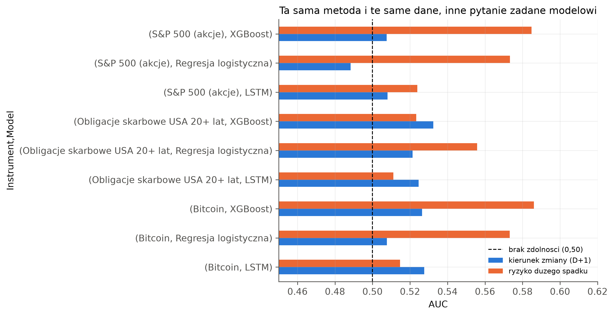
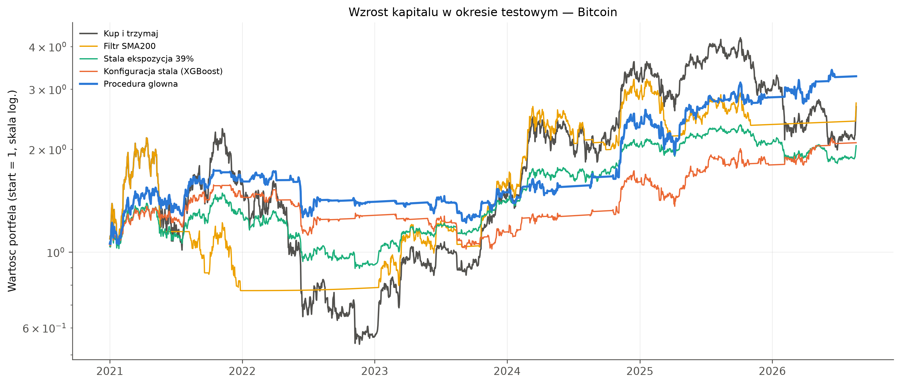
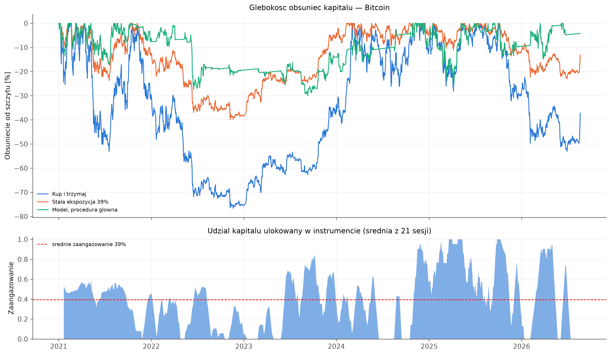
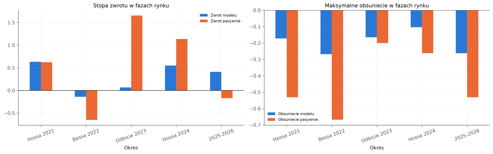
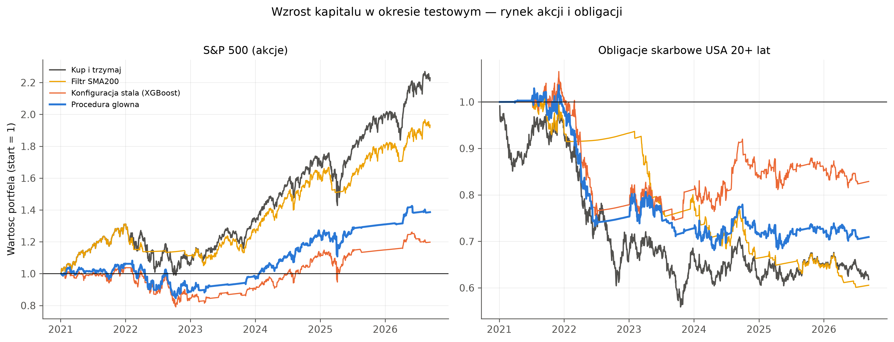
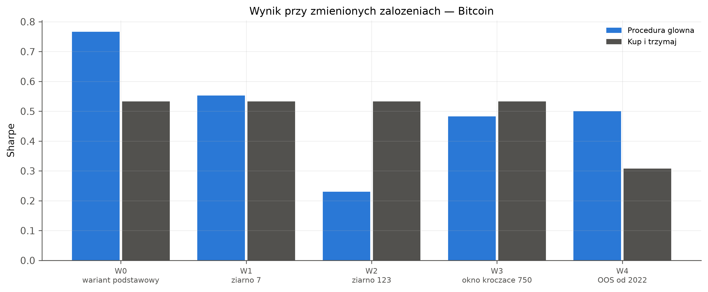

[English](README.md) · **Polski**

# Buy & Hold a strategie oparte na uczeniu maszynowym: BTC, SPY, TLT

Skrócona wersja mojej pracy magisterskiej (AGH, informatyka i ekonometria). Sprawdzałem, czy reguły inwestycyjne oparte na regresji logistycznej i XGBoost wypadają lepiej niż zwykłe kupienie i trzymanie bitcoina, funduszu na S&P 500 (SPY) i funduszu długoterminowych obligacji USA (TLT). Okres testowy trwa od stycznia 2021 r. do sierpnia lub września 2026 r., a wszystkie wyniki uwzględniają koszty transakcyjne.

**Wynik główny:** na BTC adaptacyjna strategia XGBoost zmniejszyła maksymalne obsunięcie z −77% do −30% i podniosła wskaźnik Sharpe'a z 0,53 do 0,77. Przewaga Sharpe'a nie jest jednak istotna statystycznie (p = 0,43) i nie powtarza się na SPY, TLT ani ETH.

**Narzędzia i metody:** Python (pandas, NumPy, scikit-learn, XGBoost, TensorFlow/Keras) · klasyfikacja z użyciem uczenia maszynowego (regresja logistyczna, gradient boosting, LSTM) · inżynieria cech · strojenie hiperparametrów · niezbalansowane klasy · walidacja krocząca z purge i embargo · ważność cech · backtest z kosztami transakcyjnymi · testy statystyczne (bootstrap, Pesaran-Timmermann, Jobson-Korkie-Memmel, White Reality Check, Hansen SPA)

## Dane i podejście

- **Dane:** dzienne notowania z Yahoo Finance (`yfinance`) od 2017 r., a okres testowy zaczyna się w 2021 r. Zmienne obejmują wskaźniki techniczne, zmienne rynkowe (VIX, zmiany rentowności obligacji USA, fundusze obligacji korporacyjnych, dolar, złoto), a dla BTC także dane on-chain, indeks Fear & Greed i stopy finansowania kontraktów. ETH służy tylko do weryfikacji.
- **Zadania prognostyczne:** kierunek zmiany ceny w kolejnej sesji oraz to, czy w kolejnej sesji *nie* wystąpi duży spadek (dzienna stopa zwrotu poniżej −1,5 × dziennej zmienności z 20 sesji). Drugie zadanie jest główne.
- **Modele:** regresja logistyczna, XGBoost i niewielka sieć LSTM jako model pomocniczy.
- **Walidacja:** krocząca, z rozszerzającym się oknem treningowym. Okna testowe mają po 42 sesje, a między treningiem i testem jest bufor: purge 50 i embargo 5 sesji (49 okien dla BTC).
- **Strategie na BTC:**
  - *Buy & Hold.*
  - *Stała ekspozycja:* stała waga BTC równa średniemu zaangażowaniu strategii adaptacyjnej (39%), a reszta w gotówce.
  - *Filtr SMA200.*
  - *Konfiguracja stała XGBoost:* wejście powyżej 0,55, wyjście poniżej 0,45, co najmniej 5 sesji w pozycji, docelowa zmienność 30%. To punkt odniesienia.
  - *Procedura adaptacyjna XGBoost:* strategia główna. W każdym oknie testowym wybiera na podstawie wcześniejszych okien najlepsze konfiguracje z siatki 192 ustawień reguły i uśrednia ich pozycje.
- **Koszty:** 0,1% od zmiany pozycji, a gotówka jest oprocentowana stopą wolną od ryzyka.

## Wyniki

### Zmiana pytania pomaga bardziej niż zmiana modelu



Kierunek zmiany ceny w kolejnej sesji jest bliski rzutowi monetą: AUC od 0,49 do 0,53 na wszystkich rynkach i dla wszystkich modeli. Brak dużego spadku prognozuje się lepiej. XGBoost na BTC osiąga AUC 0,586, a jego test Pesarana-Timmermanna (p = 0,0003) jako jedyny z 18 pozostaje istotny po korekcie Bonferroniego.

### BTC: wyższy zwrot przy znacznie płytszym obsunięciu



| Strategia | Zwrot | Maks. obsunięcie | Sharpe | Sortino | Calmar |
|---|---|---|---|---|---|
| Buy & Hold | 166% | −76,6% | 0,53 | 0,78 | 0,25 |
| Stała ekspozycja 39% | 105% | −39,8% | 0,53 | 0,78 | 0,34 |
| Filtr SMA200 | 173% | −64,3% | 0,56 | 0,84 | 0,30 |
| Konfiguracja stała XGBoost | 109% | −35,2% | 0,56 | 0,84 | 0,40 |
| **Procedura adaptacyjna XGBoost** | **227%** | **−30,0%** | **0,77** | **1,19** | **0,78** |

Procedura adaptacyjna ma najlepsze miary skorygowane o ryzyko w tabeli. Na wykresach z pracy występuje jako „Procedura glowna”, a Buy & Hold jako „Kup i trzymaj”.

### Liczy się moment, a nie tylko mniejsza ekspozycja



Przy tym samym średnim zaangażowaniu (39%) procedura kończy z wynikiem 227%, a stała ekspozycja ze 105%. Obsunięcie procedury jest przy tym mniejsze (−30% wobec −40%). Przewaga wynika więc z tego, kiedy strategia jest w rynku, a nie tylko z trzymania mniejszej ilości bitcoina. Potwierdza to permutacja blokowa: rzeczywisty rozkład pozycji w czasie wypada lepiej niż 95,6% losowo przetasowanych.

### Gdzie strategia zyskuje, a gdzie traci



W hossie 2021 r. strategia dorównała rynkowi (+63% wobec +62%) przy trzykrotnie płytszym obsunięciu. W bessie 2022 r. straciła 14%, gdy Buy & Hold stracił 65%. Koszt widać w odbiciach: w 2023 r. zarobiła 7%, a Buy & Hold 166%.

### Wynik nie przenosi się na inne rynki



| Rynek | Sharpe procedury | Sharpe Buy & Hold | Obsunięcie procedury | Obsunięcie Buy & Hold |
|---|---|---|---|---|
| SPY | 0,27 | 0,74 | −21,9% | −24,5% |
| TLT | −0,86 | −0,69 | −34,3% | −43,7% |
| ETH | 0,54 | 0,63 | −57,0% | −79,4% |

Na SPY pozostawanie poza rosnącym rynkiem kosztowało znacznie więcej, niż chroniło. TLT tracił niezależnie od strategii. ETH potwierdza płytsze obsunięcie, ale nie wyższy wskaźnik Sharpe'a.

### Przewaga Sharpe'a jest krucha, ograniczenie obsunięcia nie



Sama zmiana ziarna generatora przesuwa wskaźnik Sharpe'a z 0,77 do 0,55 lub 0,23, a średnia z trzech ziaren (0,52) jest nieco niższa niż dla Buy & Hold (0,53). We wszystkich pięciu scenariuszach obsunięcie pozostaje płytsze niż przy Buy & Hold. Przewaga znika przy koszcie transakcyjnym około 0,33%, czyli ok. trzy razy wyższym od przyjętego.

## Wnioski

- Modele uczenia maszynowego potrafią powiedzieć coś użytecznego o ryzyku dużego spadku na BTC, ale prawie nic o kierunku zmiany ceny w kolejnej sesji.
- Na BTC główną korzyścią jest kontrola ryzyka: dużo płytsze obsunięcie przy porównywalnym lub wyższym zwrocie. Wyższy Sharpe nie jest istotny statystycznie, a testy White'a (Reality Check) i Hansena (SPA) nie wykazują przewagi po uwzględnieniu wielokrotnych porównań.
- Wyniki mocno zależą od rynku i decyzji metodologicznych (ziarno, siatka parametrów, koszty, skład puli modeli), dlatego traktuję badanie jako eksploracyjne, a nie jako dowód na przewagę możliwą do wykorzystania w praktyce.

## Ograniczenia

- Wariant główny (tylko XGBoost) wybrano po porównaniu z dwoma wariantami wielomodelowymi na tym samym okresie, więc wynik główny jest optymistyczny.
- Sygnały korzystają z zamknięcia dnia *t* i są wykonywane po tym samym zamknięciu, a godzin publikacji danych nie odtwarzano.
- Wiele konfiguracji siatki ma identyczny wynik na historii. Sama kolejność rozstrzygania takich remisów przesuwa Sharpe'a na BTC w przedziale ok. 0,70–0,78, a obsunięcie zostaje w przedziale od −29% do −32%. `analysis.ipynb` sortuje tak samo jak przy obliczeniach do pracy, więc liczby zgadzają się na każdym komputerze.
- Trzy rynki główne i jedna dodatkowa kryptowaluta, ok. 5,5 roku danych testowych.

## Struktura repozytorium

```
analysis.ipynb        krótki notatnik odtwarzający najważniejsze liczby z zapisanych prognoz
thesis_helpers.py     wczytuje kod pracy i zachowuje kolejność remisów taką jak w pracy
thesis_code/          oryginalne notatniki z pracy (implementacja + pełna analiza z wynikami)
cache/                zapisane dane rynkowe i prognozy z walidacji kroczącej (ok. 6 MB), bez ponownego uczenia
results/              tabele zapisane przez analysis.ipynb (CSV)
img/                  wykresy z pracy
```

Kod pracy ma polskie nazwy, bo w tej postaci jest opisany w pracy. `analysis.ipynb` korzysta z niego pod angielskimi nazwami.

## Jak uruchomić

```powershell
python -m venv .venv
.\.venv\Scripts\Activate.ps1
pip install -r requirements.txt
```

Następnie otwórz `analysis.ipynb` w VS Code (albo w Jupyterze), wybierz kernel `.venv` i uruchom wszystkie komórki. Notatnik działa krócej niż minutę: wczytuje prognozy z `cache/` i nie uczy modeli ani nie pobiera danych od nowa. TensorFlow nie jest potrzebny, bo służył tylko do uczenia LSTM.

---
Michał Narewski · MSc Computer Science and Econometrics, AGH University of Krakow · [GitHub](https://github.com/narewskimichal)
